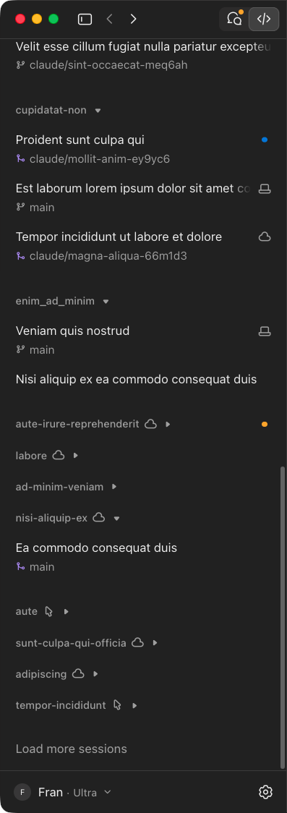
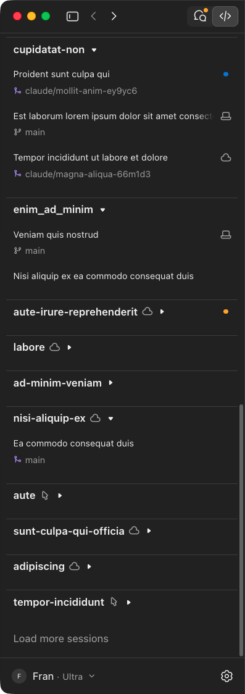

# Claude Desktop Sidebar

Small CSS hack to make project names stand out in the Claude Desktop Code sidebar. Not a project, more of a scratched itch.

## Keywords

 * Claude Desktop custom CSS
 * Claude Code Desktop sidebar project headers
 * Claude Desktop sidebar font size
 * Claude Desktop Developer Mode / DevTools
 * Make project groups visible in the Claude Code sidebar

## TL;DR

 * enable Developer Mode: **Help > Troubleshooting > Enable Developer Mode...**
 * save the snippet below as a DevTools snippet
 * after each app launch: click into the sidebar, ⌘⌥I, ⌘P, `!sidebar`, Enter
 * project names, visible

## WWW the Sidebar?

> (What's Wrong With)

The Code tab sidebar groups sessions by project (if you turn that option on). Which is nice and useful. Except that when I look at it, I can never find anything for liek 1.67 seconds. My eyes land on individual session title,
and without the project they belong the titles temselved are usually not that useful. So the first thing I'm looking for is almost always the project name. And just being flooded with session titles.

No wonder: project names are 12px and grey (~50% white), the session titles under them are 14px and bright (~90% white). Who designed this?!

> By the power of working 3% of the time on UI, I judge thee unworthy!

Um... too much? Ok.

Before and after (names lorem-ipsum'd, obviously):

<table>
  <tr><th>Before</th><th>After</th></tr>
  <tr>
    <td></td>
    <td></td>
  </tr>
</table>

## Isn't there a setting for that?

Not that I could find.

## Mods then? Claude Code has mods now.

It does! So I asked Claude to make one. Turns out a mod lives inside one session: panes, status line, the transcript. The sidebar belongs to the app itself, mods can't reach it.

## Ok, it's Electron app. Just inject some CSS?

Ha! Sure! Had Claude dig through the app to see what's possible:

 * `--remote-debugging-port`: the app refuses to start. On purpose. Fair enough, moving on.
 * Patching the app bundle: the app checks its own files against hashes, so a patch means re-signing the whole thing yourself. Which (most likely) breaks auto-updates, makes Keychain ask questions, and resets macOS permissions. No thanks.
 * Developer Mode: supported, one menu click, DevTools included. 🎉

## So, Developer Mode it is

The catch: CSS added via DevTools lives only until the app quits (or the page fully reloads). So it has to be re-applied after each launch.

That's fine, though. DevTools has saved snippets, and they survive app restarts. They are stored in `~/Library/Application Support/Claude/Preferences`, outside the app bundle, so app updates should keep them too.

5 seconds per app launch. I can live with that. For now. Until I decide some AppleScript is dearly needed.

## LP;DR?

1. Enable Developer Mode: in the macOS menu bar (not the in-app Settings), **Help > Troubleshooting > Enable Developer Mode...**. Confirm, restart the app.
2. Click into the sidebar, press `⌘⌥I`. DevTools opens.
3. **Sources** tab > **Snippets** (left pane, behind `»` because of course) > **+ New snippet**. Rename it to `sidebar`.
4. Paste the code below, `⌘S`.
5. Run it: `⌘↩`.

After each launch: click into the sidebar, `⌘⌥I`, `⌘P`, type `!sidebar`, Enter. Close DevTools.

> AppleScript? 🫤 Ohhhh...

## The snippet

Claude-generated, and the I tuned it by eye. My extensive human-powered taste and judgement forged in 15+ years of building web apps of all sorts and sizes, made a critical contribution: `13px` -> `12px` for the session titles.

```js
// Claude Code sidebar: make project group headers stand out from the sessions under them.
//
// Run in DevTools of Claude Desktop's main view (saved as a DevTools snippet).
// Running it again replaces the previous version of the style, so it is safe to re-run.
//
// Defaults as of 2026-11-01 (for comparing after Claude updates):
//   project header: 12px, wght 480, colour --cds-text-muted   (≈57% white in dark mode)
//   session title:  14px, wght 400, colour --cds-text-primary (≈93% white in dark mode)
//   branch line:    13px, wght 400, colour --cds-text-muted
(() => {
  const STYLE_ID = 'sidebar-project-headers';
  const HEADER = '[data-sidebar-group-label][data-kind="group"]';
  // Session rows (code sessions and chats). The top navigation (New, Search, ...) has no row key.
  const SESSION = '[data-row-key] [data-row-main-button]';

  // !important is needed: the app sets --df-group-font through a very specific selector
  // behind a feature flag.
  const css = `
    ${HEADER} {
      --df-group-font: 14px !important;   /* header text size; was 12px */
      --df-own-pt: 10px !important;       /* space between divider and header text */
      margin-top: 14px !important;        /* space between previous group and divider */
      border-top: 1px solid var(--cds-border-line) !important;
    }
    ${HEADER} button[data-group-toggle],
    ${HEADER} [data-group-name] {
      color: var(--cds-text-primary) !important;
      font-variation-settings: "GRAD" 0, "wght" 620 !important;
    }
    ${SESSION} {
      --df-row-font: 12px !important;     /* session title; was 14px */
    }
    ${SESSION} .df-row-description {
      font-size: 12px !important;         /* branch line; was 13px */
    }
  `;

  document.getElementById(STYLE_ID)?.remove();
  const style = document.createElement('style');
  style.id = STYLE_ID;
  style.textContent = css;
  document.head.appendChild(style);

  const headerCount = document.querySelectorAll(HEADER).length;
  if (headerCount === 0) {
    console.warn(
      `[${STYLE_ID}] Style added, but no project headers are on the page. ` +
      'Either the Code sidebar is not showing, or Anthropic changed its markup ' +
      '(check whether this override is still needed).'
    );
  } else {
    console.log(`[${STYLE_ID}] Style applied to ${headerCount} project headers.`);
  }
})();
```

## What else?

There are issues for this, please upvote:

 * [anthropics/claude-code#102631](https://github.com/anthropics/claude-code/issues/102631): Code tab sidebar: project headers are hard to tell apart from session titles
 * [anthropics/claude-code#102699](https://github.com/anthropics/claude-code/issues/102699): Desktop: sidebar theming / user CSS (bolder project headings)

Then I can delete the snippet. 🌱
